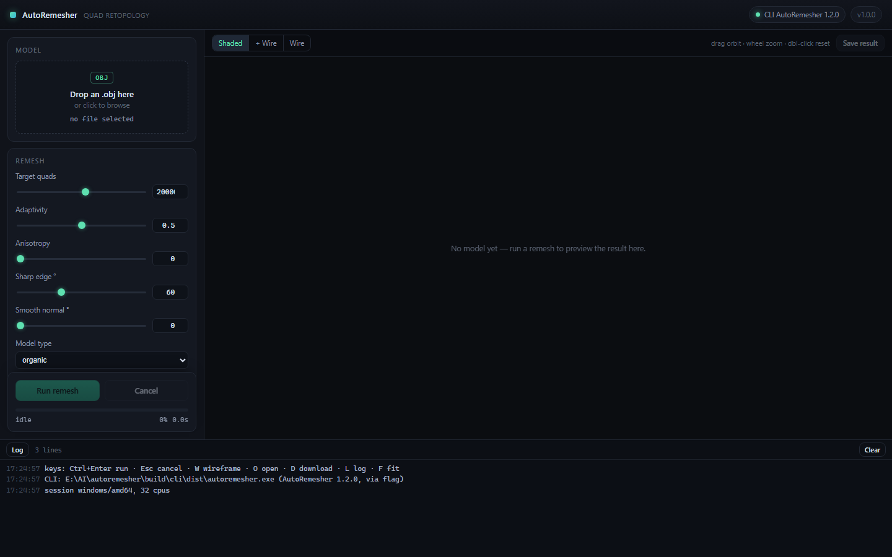

# AutoRemesher

AutoRemesher is a cross-platform automatic quad remeshing tool that converts
high-polygon meshes into clean quad-based topology. The remeshing core is built on
[Eigen](https://eigen.tuxfamily.org/), [TBB](https://github.com/oneapi-src/oneTBB),
[isotropicremesher](https://github.com/huxingyi/isotropicremesher) and
[meshoptimizer](https://github.com/zeux/meshoptimizer); the full list is in
[ACKNOWLEDGEMENTS.html](ACKNOWLEDGEMENTS.html).

> **No Qt.** The project no longer links Qt (or OpenGL) anywhere. The remeshing
> engine is a plain C++14 library, the application entry point is a headless CLI,
> and the graphical interface is a separate Go program. See
> [Architecture](#architecture) and [Migrating from the Qt GUI](#migrating-from-the-qt-gui).

Buy me a coffee for staying up late coding :-)
[](https://www.paypal.com/cgi-bin/webscr?cmd=_donations&business=GHALWLWXYGCU6&item_name=Support+me+coding+in+my+spare+time&currency_code=AUD&source=url)

## Architecture

| part | path | built by | what it is |
|---|---|---|---|
| core | `src/AutoRemesher` | CMake (`autoremesher_core`) | C++14 quad remeshing pipeline: surface mesh, frame field, parameterization, quad cover, quad extraction. No GUI, no Qt. |
| CLI | `src/cli/main.cpp` | CMake (`autoremesher`) | **The main executable.** Loads an OBJ, remeshes, writes a quad OBJ, speaks a JSON-lines protocol for the GUI. |
| GUI | `gui/` | Go (`autoremesher-gui`) | Separate executable: a Go program (local HTTP server + embedded UI) that spawns the CLI and streams its progress. |
| benchmark | `bench/` | CMake | Headless timing harness for the core (A/B numbers, thread pinning). |

The CLI never starts a GUI, and the GUI never links the engine: the process boundary
is the JSON protocol in [docs/cli-protocol.md](docs/cli-protocol.md).

```
gui/autoremesher-gui --spawn--> autoremesher.exe --json --> core library
        ^                            |
        +---- JSON lines / OBJ <-----+
```

## Building

### Prerequisites

- C++14 compiler (MSVC 2019+, GCC 8+, Clang 10+)
- CMake 3.20+ and a generator (Ninja or Visual Studio)
- TBB: the vendored 2017 source in `thirdparty/tbb` is built once by
  `build/build_tbb.bat`; on Linux/macOS install a system TBB (`libtbb-dev`,
  `brew install tbb`) and CMake will find it
- Go 1.21+ — only for the graphical interface

### Windows (Visual Studio 2022/2026)

```cmd
build.bat
```

That builds the static TBB (once), the CLI, and the Go GUI:

- `build\cli\dist\autoremesher.exe`
- `gui\dist\autoremesher-gui.exe`

CLI only:

```cmd
scripts\build_cli.bat
```

### Linux / macOS

```bash
cmake -S . -B build/cli -DCMAKE_BUILD_TYPE=Release
cmake --build build/cli -j
# GUI (optional)
cd gui && go build -o dist/autoremesher-gui ./cmd/autoremesher-gui
```

`AR_TBB_STATIC_LIB` defaults to the Windows-only `build/tbb/tbb_static.lib`; when
it does not exist CMake falls back to `find_package(TBB)`.

## Command line

```bash
autoremesher --input armadillo.obj --output armadillo_quads.obj --target-quads 50000
```

```
  -i, --input PATH            input OBJ (polygons are triangulated)
  -o, --output PATH           output OBJ of quads (default: <input>_remeshed.obj)
  -q, --target-quads N        requested quad count (default 20000)
      --adaptivity F          gradient adaptivity 0..1 (default 0.5)
      --anisotropy F          anisotropy 0..1 (default 0.0)
      --sharp-edge DEG        sharp edge threshold (default 60)
      --smooth-normal DEG     smooth normal threshold (default 0)
      --edge-scaling F        edge scale multiplier (default 1.0)
      --model-type T          organic | hard-surface
      --exact-target-quads    solve the cover scale from the quad budget
      --keep-island-fraction F, --keep-all-islands, --weld-patches,
      --legacy-holes, --projected-caps, --local-remesh, --threads N
      --json                  JSON-lines events on stdout (for the GUI)
      --progress              progress on stderr
      --verbose               per-phase report
      --quiet, --version, --help
```

Exit codes: `0` success, `1` usage/input error, `2` remeshing failed, `3` write failed.
The machine protocol (event shapes, throttling, error semantics) is documented in
[docs/cli-protocol.md](docs/cli-protocol.md).

## Graphical interface (Go)



```cmd
gui\dist\autoremesher-gui.exe --cli build\cli\dist\autoremesher.exe
```

The GUI is a Go binary with no third-party modules: it serves an embedded page on
`127.0.0.1` (random port, per-session token), opens the browser, and drives the CLI:

- drag & drop an OBJ, set parameters with sliders, run or cancel a job
- live progress, per-phase report, log pane
- WebGL preview of the resulting quad mesh (orbit, zoom, wireframe)
- save the remeshed OBJ

CLI discovery order: `--cli` flag, next to the GUI executable, `..\dist`, then
`PATH`. See [gui/README.md](gui/README.md) for the flags and the design.

## Migrating from the Qt GUI

- `src/mainwindow.cpp`, `src/quadmeshgenerator.cpp`, the OpenGL preview classes,
  `thirdparty/QtAwesome`, `thirdparty/QtWaitingSpinner`, `shaders/`,
  `resources.qrc` and `autoremesher.pro` were deleted; `git log` keeps the history.
- Live intermediate previews (source / isotropic / parameterization / singularities)
  are not part of the Go GUI: the CLI exposes the final quad mesh. The core still
  produces those intermediates, so a future `--dump-stage` option can feed a viewer.
- The old `--report FILE` spelling is gone; use `--verbose`, which prints the same
  phase report (and emits it as a `report` JSON event under `--json`).

## Benchmark

`bench/` still drives the core directly, without Qt:

```cmd
bench\build_bench.bat
build\bench\arbench.exe --input model.obj --target-quads 15000 --repeat 3 --verbose
```

See [bench/README.md](bench/README.md) for the options and the local topology
optimisation notes.

## License

AutoRemesher is licensed under the MIT License — see [LICENSE](LICENSE).

## Links

- [Check out open-source auto-retopology tool AutoRemesher](http://www.cgchannel.com/2020/08/check-out-open-source-auto-retopology-tool-autoremesher/) **cgchannel.com**
- [A New Open-Source Auto-Retopology Tool](https://80.lv/articles/a-new-open-source-auto-retopology-tool/) **80.lv**
- [[Non-Blender] Autoremesher auto-retopology tool released](https://www.blendernation.com/2020/08/18/non-blender-autoremesher-auto-retopology-tool-released/) **blendernation.com**
- [Open Source AutoRemesher released](https://cgpress.org/archives/open-source-remesher.html) **cgpress.org**

<!-- Sponsors begin --><!-- Sponsors end -->
